# Evaluation methodology: from the chunk-size sweep to prompt optimisation

This document describes the statistical design of the evaluation tooling in
[redactor/eval](.): what is measured, how the estimators behave, how many documents and
repeats a comparison needs, and how decisions are made. For commands see
[README.md](README.md). Where a quantity is an assumption rather than something the code
computes, it is marked as such.

```mermaid
flowchart LR
  C[Labelled corpus<br/>dev / test split by document] --> S[Chunk sweep<br/>variants x documents x repeats]
  S --> M[Entity-level scoring<br/>pooled counts]
  M --> B[Paired document bootstrap<br/>+ guardrails + cost]
  B --> V[Chosen chunk_size / overlap]
  V --> R[Register prompts<br/>MLflow registry]
  R --> E[Evaluate on dev chunks<br/>noise floor]
  E --> O[Optimise: MetaPrompt, GEPA<br/>objective J on chunk records]
  O --> G[Gate on whole test documents<br/>paired bootstrap]
  G --> X[Export champion to YAML]
```

## 1. Data and unit of analysis

A corpus document $d$ has text and a set of labelled entities $e$, each with a rule, a
category and a flag `redact`:

- **Positives** $\mathcal{P}_d(r)$: spans that rule $r$ must redact.
- **Hard negatives** $\mathcal{H}_d(r)$: spans that look sensitive but must be kept
  (authors, Councillors, generic mailboxes, "40+ years", vague species locations).

Documents are the independent sampling unit. Entities in one document share authors,
people and boilerplate, and chunks of one document share entities, so entity- and
chunk-level observations are **clustered by document**. Every resampling, split and
variance estimate below is therefore done at document level. Documents are assigned to
`dev` or `test` once, so no document informs both tuning and the final decision.

## 2. Scoring

### 2.1 Matching

Text is lower-cased, possessives are removed and it is split into words, with an email
address as one word. A prediction $p$ and entity $e$ are word sequences $w(p)$, $w(e)$.
Predictions are redaction *strings*, applied wherever they occur, as in production. A
prediction is **locatable** if $w(p)$ occurs contiguously in the document. Predictions
that are not locatable cannot be applied; they are counted separately and excluded from
precision.

**Coverage** of an entity by the set $\mathcal{L}$ of locatable predictions is

$$
c(e,\mathcal{L}) =
\begin{cases}
1 & \text{if some } w(p) \text{ contains } w(e) \\[2pt]
\dfrac{\bigl|\bigcup_{p \in \mathcal{L}} \{\, i : w(e)_{i} \text{ lies in a match of } w(p) \text{ inside } w(e)\,\}\bigr|}{|w(e)|} & \text{otherwise.}
\end{cases}
$$

An entity is a **true positive** if $c(e,\mathcal{L}) \ge \tau$ (default $\tau = 0.8$). The
threshold mirrors the production matcher, which redacts partially matched spans.

A locatable prediction $p$ is classified by overlap ($w(p)$ contains $w(e)$ or vice
versa):

| Class | Condition |
| --- | --- |
| Correct | overlaps a positive of the scored rule |
| Cross-rule | otherwise, overlaps a positive of a *different* rule |
| False positive | overlaps no positive of any rule |

A **hard-negative hit** is a hard negative overlapped by a *false positive* prediction. A
prediction that also overlaps a positive counts as correct, not as a hit.

### 2.2 Metrics

For one document (or counts pooled over documents), with $P$ positives, $TP$ true
positives, $C$ correct predictions, $FP$ false positives, $H$ hard negatives and $H_{\text{hit}}$
hits:

$$
\text{Recall}\ R = \frac{TP}{P}, \qquad
\text{Precision}\ \Pi = \frac{C}{C+FP}, \qquad
\text{HN rate} = \frac{H_{\text{hit}}}{H}.
$$

By convention $R = 1$ when $P = 0$ and $\Pi = 1$ when $C + FP = 0$.

**$TP$ and $C$ count different things.** $TP$ counts *entities*: an entity is a true
positive when the locatable predictions *jointly* cover at least $\tau$ of its words
(§2.1), and it enters recall. $C$ counts *distinct predictions* (after normalising and
de-duplicating): a prediction is correct when it overlaps at least one positive of the
scored rule, however little of that entity it covers, and it enters precision. Neither
needs the other to hold, and either can be the larger:

| Situation | $TP$ | $C$ |
| --- | --- | --- |
| Entity `Joan Whitcombe`, predictions `Joan` and `Whitcombe` | 1 (union covers 100%) | 2 (each overlaps the entity) |
| Entity `Joan Whitcombe`, one prediction `Whitcombe` | 0 (50% < $\tau$), a partial positive | 1 (it overlaps) |
| Entity `Joan Whitcombe`, prediction `Joan Whitcombe objects` | 1 | 1 |
| Predictions `Joan Whitcombe` and `Joan Whitcombe's`, which normalise to the same words | 1 | 1 (merged before counting) |
| One prediction overlapping two entities | 2 | 1 |

So a partial match costs recall (the entity is a false negative) but not precision (the
prediction is still correct). Splitting one entity over several predictions can make
$C > TP$, and one broad prediction spanning several entities can make $TP > C$. Cross-rule
and unlocatable predictions are in neither $C$ nor $FP$.

$$
F_\beta = \frac{(1+\beta^2)\,\Pi R}{\beta^2 \Pi + R}
\qquad\Longleftrightarrow\qquad
\frac{1}{F_\beta} = \frac{1}{1+\beta^2}\left(\frac{\beta^2}{R} + \frac{1}{\Pi}\right).
$$

$\beta = 2$ is the primary metric: a weighted harmonic mean in which recall carries four
times the weight of precision, in line with "if in doubt, take it out". Because $\Pi$
counts *predictions* and $R$ counts *entities* (the distinction above), $F_\beta$ is not the
usual count form $(1+\beta^2)TP / \bigl((1+\beta^2)TP + \beta^2 FN + FP\bigr)$.

Other reported quantities:

- **Unlocatable rate** $U$: the share of predictions that cannot be applied because they
  do not occur in the text. See below.
- **Boundary recall** $R_{\partial}$: recall over entities that do not fit wholly inside
  any one chunk. It isolates the cost of chunk boundaries.
- **Combined score** (`__all__`): predictions of all rules are concatenated and scored
  against all labels, as production applies them. Only complete groups (every rule
  present for a document, variant and repeat) are combined.

#### Unlocatable rate

Let $\mathcal{S}$ be the set of distinct predictions after normalisation, with predictions
that normalise to no words (e.g. only punctuation) dropped. Let $\mathcal{L} \subseteq \mathcal{S}$
be the locatable ones, i.e. $w(p)$ occurs contiguously in the document's words (§2.1). Then

$$
U = \frac{|\mathcal{S}| - |\mathcal{L}|}{|\mathcal{S}|}
  = \frac{N_{\text{unloc}}}{C + FP + N_{\text{cross}} + N_{\text{unloc}}},
$$

with $U = 0$ when there are no predictions. The second form shows that the four
prediction classes partition $\mathcal{S}$: correct, false positive, cross-rule and
unlocatable. Pooled over documents it is a ratio of sums,
$U = \sum_d N_{\text{unloc},d} / \sum_d |\mathcal{S}_d|$.

- **Why it matters.** Production redacts by string search, so a string that is not in the
  text redacts nothing. The prediction is wasted output, and it signals that the model
  paraphrased, expanded, shortened or normalised a span instead of copying it verbatim,
  which the prompt forbids. In production it appears as the run metric
  `unapplied_text_redaction_terms`. A span that was meant to be redacted but came back
  altered is also a missed redaction, so a high $U$ usually comes with lower recall.
- **Why it is separate from precision.** Unlocatable predictions are in neither $C$ nor
  $FP$, so they do not lower $\Pi$. Without a separate measure they would be invisible in
  precision, which is why $U$ is reported on its own and is penalised in the optimiser's
  objective (§6.4).
- **Matching rules.** Comparison is on normalised words, so case, punctuation and
  possessives do not make a prediction unlocatable. The one special case is a single term
  that is the name part of an email address in the document (`ada.merrin` for
  `ada.merrin@post.invalid`), which stands for the whole address, because that is what the
  redactor redacts. Locatability is checked against the document being scored: the whole
  document in the sweep and gate, the chunk in chunk-level optimisation records. A string
  found only in another chunk of the same document is locatable at document level.
- **Reading it.** $U$ is about *format fidelity*, not about whether the redaction is
  right. A prediction can be locatable and wrong (a false positive), or unlocatable and
  correct in intent. Because the rate is over a small number of predictions per chunk, it
  is noisy at record level and informative only when averaged over many records. The sweep
  summary reports the raw count (`unlocatable_predictions`); the rate is computed by the
  `unlocatable_rate` scorer and so appears per record in MLflow.

### 2.3 Pooling

Counts are summed over documents and repeats before computing ratios (micro-averaging):

$$
\hat F_\beta = F_\beta\!\left(\Pi\!\left(\textstyle\sum_d C_d,\ \sum_d FP_d\right),\ R\!\left(\textstyle\sum_d TP_d,\ \sum_d P_d\right)\right).
$$

This weights a document by its number of labels. It is a ratio estimator, so its
sampling variance depends on the cluster structure, not on $P$ alone. For recall, with
$D$ documents and mean cluster size $\bar P$,

$$
\widehat{\operatorname{Var}}(\hat R) = \frac{1}{D\,\bar P^{2}}\cdot\frac{1}{D-1}\sum_{d=1}^{D}\bigl(TP_d - \hat R\,P_d\bigr)^2 .
$$

The bootstrap in §5 is used for $F_\beta$ instead of the delta method, because $F_\beta$
is a nonlinear function of four pooled totals.

## 3. Chunk-size sweep

### 3.1 Design

A **variant** is a pair $v = (s, o)$ of chunk size and overlap in tokens, with
$o = \min(\operatorname{round}(\rho s),\ s-1)$ for an overlap ratio $\rho \in \{0, 0.04, 0.1\}$.
Distinct pairs are de-duplicated, since rounding can map different ratios to one
overlap. Every (repeat $k$, document $d$, variant $v$, rule $r$) combination is one run,
and one JSONL row stores the raw predictions and token usage, so rescoring never calls
the LLM again.

- **Fully crossed, paired design.** Every variant sees the same documents and repeats, so
  variant differences are paired by document.
- **Interleaving.** Variants are interleaved within each document, so drift in latency or
  throttling affects all variants alike. Time-varying effects are therefore not confounded
  with chunk size.
- **Frozen prompt.** The prompt, model, `max_completion_tokens` and `reasoning_effort` are
  held fixed across the sweep. Changing them invalidates the comparison.

### 3.2 Cost model

For a document of $T$ tokens, chunks of $s$ tokens, overlap $o$ and a system prompt of
$p$ tokens, the number of requests and input tokens are approximately

$$
n(s,o) = \left\lceil \frac{T-o}{s-o} \right\rceil, \qquad
N_{\text{in}} \approx n\,p + T\,\frac{s}{s-o}.
$$

Small chunks pay for the prompt $n$ times, large chunks pay for long reasoning and
truncated outputs. Cost uses the model's four token prices, and `prompt_tokens` already
includes cached and cache-write tokens, as `completion_tokens` includes reasoning tokens:

$$
\text{cost} = c_{\text{in}}\,(N_{\text{in}} - N_{\text{cached}} - N_{\text{write}})
 + c_{\text{cached}} N_{\text{cached}} + c_{\text{write}} N_{\text{write}}
 + c_{\text{out}} N_{\text{out}}.
$$

Variants are compared on cost per 1,000 document tokens, $1000\cdot\text{cost}/\sum T$.
Because $c_{\text{cached}} / c_{\text{in}} = 2/16$, a static prompt prefix of 1,024 or more
tokens makes the $np$ term much cheaper than the list price suggests. Check that
`cached_input_tokens` is non-zero before trusting cost differences between sizes. For the
combined `__all__` rows, cost sums all rules' runs while document tokens are counted once,
so cost per 1,000 tokens is the cost of every rule together.

## 4. Variance structure, repeats and sample size

### 4.1 Model

Let $X_{dk}$ be the per-document $F_\beta$ for document $d$ and repeat $k$ at a fixed
variant. The chunker is deterministic, so repeat-to-repeat variation is LLM
nondeterminism only. Treat the design as a one-way random-effects model:

$$
X_{dk} = \mu + a_d + \varepsilon_{dk}, \qquad
a_d \sim (0,\sigma_d^2), \quad \varepsilon_{dk} \sim (0,\sigma_w^2).
$$

$\sigma_d^2$ is genuine document-to-document heterogeneity and $\sigma_w^2$ is run-to-run
noise. The variance of the grand mean over $D$ documents and $K$ repeats is

$$
\operatorname{Var}(\bar X) = \frac{\sigma_d^2}{D} + \frac{\sigma_w^2}{DK}.
$$

### 4.2 Estimators in the summary

With per-document means $\bar X_d$, the summary reports

$$
\hat\sigma_w^2 = \frac{1}{D}\sum_d \frac{1}{K-1}\sum_k (X_{dk}-\bar X_d)^2, \qquad
S_b^2 = \frac{1}{D-1}\sum_d (\bar X_d - \bar{\bar X})^2
$$

as `within_doc_variance` and `between_doc_variance`. $S_b^2$ is the variance of the
document *means*, so $\mathbb{E}[S_b^2] = \sigma_d^2 + \sigma_w^2/K$ and it overstates the
true between-document variance. The method-of-moments estimate is

$$
\hat\sigma_d^2 = \max\!\left(0,\ S_b^2 - \hat\sigma_w^2 / K\right),
\qquad
\widehat{\text{ICC}} = \frac{\hat\sigma_d^2}{\hat\sigma_d^2 + \hat\sigma_w^2}.
$$

The model assumes $\sigma_w^2$ is the same for every document and a balanced design (the
same repeats for every document). Per-document $F_\beta$ is bounded and discrete when a
document has few entities, so the variance estimates are approximate, and dropped runs are
not handled.

A high within-document variance means repeats are needed to trust a comparison. A high
$\hat\sigma_d^2$ means the corpus is heterogeneous for that variant and more documents are
needed, which repeats cannot fix.

**Consistency** is the share of (document, entity) pairs with the same outcome in all
repeats:

$$
\text{consistency} = \frac{1}{|\mathcal{E}|}\sum_{(d,e)\in\mathcal{E}} \mathbb{1}\!\bigl[\,|\{\mathbb{1}[c_{dke}\ge\tau] : k\}| = 1\,\bigr].
$$

It is an entity-level, nondeterminism-only view of reliability. Values well below 1
indicate decisions near the model's boundary. The code keys pairs by entity text, so
duplicate entity texts within a document collapse into one pair, and with $K=1$ the value
is trivially 1.

### 4.3 Comparing two variants: how many documents

For two variants (or prompts) $A$ and $B$ on the same documents, let the per-document
paired difference be $\delta_d = \bar X^A_d - \bar X^B_d$. It decomposes as

$$
\operatorname{Var}(\delta_d) = \sigma_{\Delta d}^2 + \frac{\sigma_{\Delta w}^2}{K}.
$$

- $\sigma_{\Delta d}^2$ is the variance across documents of the *true* difference. It is a
  document-by-variant interaction. Document difficulty cancels in the pairing, so it is
  usually much smaller than $\sigma_d^2$.
- $\sigma_{\Delta w}^2$ is the variance of the run-to-run difference, which for independent
  runs is $\sigma_{w,A}^2 + \sigma_{w,B}^2$.

The standard error of the mean difference is

$$
\operatorname{SE} = \sqrt{\frac{\sigma_{\Delta d}^2 + \sigma_{\Delta w}^2/K}{D}}.
$$

To detect a true difference $\Delta$ with two-sided level $\alpha$ and power $1-\gamma$,

$$
D \;\ge\; \frac{(z_{1-\alpha/2} + z_{1-\gamma})^2\,\bigl(\sigma_{\Delta d}^2 + \sigma_{\Delta w}^2/K\bigr)}{\Delta^2},
\qquad
\text{MDE} = (z_{1-\alpha/2} + z_{1-\gamma})\operatorname{SE}.
$$

With $\alpha = 0.05$ and power $0.8$ the multiplier is $(1.96+0.84)^2 \approx 7.84$. Writing
$\sigma_\delta^2 = \sigma_{\Delta d}^2 + \sigma_{\Delta w}^2/K$ for the variance of a
document's mean difference, $D \approx 7.84\,\sigma_\delta^2/\Delta^2$:

| $\sigma_\delta$ | $\Delta = 0.02$ | $0.03$ | $0.05$ | $0.10$ |
| --- | --- | --- | --- | --- |
| 0.05 | 49 | 22 | 8 | 2 |
| 0.10 | 196 | 88 | 32 | 8 |
| 0.15 | 441 | 196 | 71 | 18 |

These use normal quantiles. At small $D$ replace them by $t_{D-1}$ quantiles, which adds a
few documents, and note the percentile bootstrap in §5 is liberal for $D \lesssim 20$.
The $\sigma$ values in the table are **illustrative assumptions**, not measured values.

This planning model is for the mean of per-document paired differences (the macro estimator
of §5.2). The gate (§7) tests the pooled $F_2$ difference, which weights documents by label
count, so the sample sizes are approximate for the gate. The assumption that
$\sigma_{\Delta d} \ll \sigma_d$ is not checked by the code.

**Estimating the inputs.** $\sigma_{\Delta w}^2$ comes from an A/A run (a prompt compared
with itself, $K \ge 2$). Because $\sigma_{\Delta d}^2 = 0$ under A/A, an A/A run gives the
*null* standard error, i.e. the noise floor, but not the interaction variance. Estimate
$\sigma_{\Delta d}^2$ from a real A/B run of baseline against candidate on the dev split,
using $\hat\sigma_{\Delta d}^2 = S^2_{\bar\delta} - \hat\sigma_{\Delta w}^2/K$, then plan the test
split with the sum.

### 4.4 Choosing the number of repeats

Repeats shrink only the $\sigma_w^2/K$ term. The standard error cannot fall below
$\sigma_{\Delta d}/\sqrt{D}$ however many repeats are run. Under a budget with cost $c_d$
per additional document (generation, label review) and $c_r$ per additional repeat of one
document (LLM cost), variance $\propto (\sigma_{\Delta d}^2 + \sigma_{\Delta w}^2/K)/D$ is
minimised at

$$
K^{*} = \sqrt{\frac{\sigma_{\Delta w}^2}{\sigma_{\Delta d}^2}\cdot\frac{c_d}{c_r}}.
$$

Since a reviewed document is far more expensive than one more LLM run, $K^*$ is usually
larger than intuition suggests, but it is capped by the point where
$\sigma_{\Delta w}^2/K \ll \sigma_{\Delta d}^2$ and more repeats are wasted. Take
$K = \operatorname{round}(K^*)$, with a minimum of 2, which is the minimum for any
variance-of-repeats estimate. Use $K \approx 5$ for the fine sweep when
$\sigma_{\Delta w}^2 \gtrsim \sigma_{\Delta d}^2$. This is a heuristic, not derived from the
formula.

## 5. Inference: paired document bootstrap

### 5.1 Pooled $F_\beta$ difference

Let $\mathcal{D}$ be the $D$ documents and $v_0$ the reference variant (the best by
$\hat F_\beta$). For $b = 1,\dots,B$ ($B = 2000$ by default):

1. Draw $D$ documents with replacement, $\mathcal{D}^{*}_b$, **once**, and use the same draw
   for every variant. Each document keeps all of its repeats.
2. Sum counts over $\mathcal{D}^{*}_b$ per variant and compute $\hat F^{*}_{v,b}$.
3. Record $\Delta^{*}_{v,b} = \hat F^{*}_{v,b} - \hat F^{*}_{v_0,b}$.

The 95% percentile interval is $[\Delta^{*}_{(0.025B)},\ \Delta^{*}_{(0.975B)}]$. Pairing
removes the large between-document component common to both variants. This is a cluster
(document) bootstrap, so within-document correlation of entities and repeats is respected.
The implementation gives a document missing from a variant zero counts, which biases that
variant, so every variant needs results for every document. Percentiles use index
`int(q * (B - 1))`, which approximates $\Delta^{*}_{(qB)}$.

### 5.2 Mean per-document $F_\beta$ (macro) difference

A second estimator reports the mean of per-document $\bar X_d$ differences,

$$
\hat\Delta = \frac1D\sum_d(\bar X^v_d - \bar X^{v_0}_d),
$$

with a percentile bootstrap over the $\delta_d$ and a `conclusive` flag when the interval
excludes 0. It weights documents equally, whereas §5.1 weights them by label count. When
the two disagree, the corpus has documents with very different label counts. The macro
version is also the better match for the optimiser's objective (§6.4), which averages
over records.

### 5.3 Selecting a chunk size

A variant is **eligible** if all of the following hold:

- $\text{upper}_{v} \ge 0$, i.e. it is not significantly worse than the best (§5.1);
- its hard-negative rate is $\le 0.2$ and its failed-chunk rate is $\le 0.01$;
- its recall is at or above each configured per-rule floor.

The recommendation is the eligible variant with the **lowest cost per 1,000 document
tokens**, with ties broken by higher $F_\beta$. It is cost minimisation subject to
non-inferiority on $F_\beta$ and to constraints on recall, hard negatives and failures.

**Caveats.**

- The reference is chosen as $\arg\max \hat F_\beta$ on the same data, which biases
  $\hat F_\beta(v) - \hat F_\beta(v_0)$ downwards (winner's curse). The rule is
  conservative towards the best variant.
- No multiplicity correction is applied across the $|\mathcal{V}|$ comparisons.
- Intervals say which variants are *distinguishable*, not that equivalent ones are
  equivalent. A wide interval that includes 0 can also be an underpowered comparison.
  Use the `ci_width` and `n_documents` fields.
- Validate the chosen variant once on the held-out `test` split (§7).

## 6. Prompt engineering

The chunk settings are fixed from §5 before prompts are changed, because prompt length
moves the optimum. Re-run a narrow sweep around the chosen size afterwards.

### 6.1 Structured output

With `include_rationale` on, each response lists redactions with their text, data subject,
cited clause IDs (`T#`, `M#`), a reason of 25 words or fewer and a confidence, plus a
capped list of near-miss exclusions (`D#`). The fields are emitted in that order, so the
reason precedes the confidence. Across the chunks of a document, decisions for the same
span are merged: highest confidence, union of clauses and a chunk count. The extra
completion tokens $N_{\text{out}}$ raise cost, so use the same `max_completion_tokens` for
any two prompts being compared. The reasons give the optimiser's reflection model
a diagnostic signal beyond a pass/fail score.

### 6.2 Registry and records

Each rule's system prompt is registered as `redaction-<rule>`, with the chunk settings in
the model config. Versions are immutable and referenced by alias (`baseline`, `candidate`,
`champion`).

**Chunk records** for optimisation: documents are split at the chosen chunk settings, and
each chunk is labelled with the entities wholly inside it, of every rule. Chunks with no
label for the rule are subsampled so that they form a fraction $\rho_{\emptyset}$
(default 0.25) of the records,

$$
n_{\emptyset} = \min\!\left(N_{\emptyset},\ \operatorname{round}\!\left(\frac{\rho_\emptyset}{1-\rho_\emptyset}\,N_{\text{lab}}\right)\right),
$$

so false positives on uneventful text are penalised without dominating the score.
Train and validation sets are split by **document** (default 30% validation), never by
chunk, because chunks of one document are correlated and a chunk split would leak.

Chunk records within a document are not independent, so the effective number of training
records is below the raw count. With an intraclass correlation $\rho_c$ and mean chunks
per document $m$, the design effect is $1 + (m-1)\rho_c$.

### 6.3 Scorers

Per record, scorers return a value and a rationale:

- `f2`, `recall`, `precision`, `hard_negative_hit_rate`, `unlocatable_rate`, each from
  the same scoring functions as §2. The `f2` rationale lists each missed positive, each
  wrongly redacted hard negative (with category and label rationale), unlabelled
  predictions and unlocatable predictions.
- `clause_citation_valid`: the share of decisions citing existing clauses of the right
  kind. It is a diagnostic only and is not in the objective.

A record with no positives scores $F_\beta = 1$ if there are no predictions and $0$ if
there is any false positive, because $\Pi = 0$ then. If every prediction is unlocatable or
cross-rule, $\Pi = 1$ and the score is 1. Unlocatable predictions are then penalised only by
$\lambda_u$ in §6.4, and cross-rule predictions are not penalised at all. Chunk records hold
the entities of every rule, so cross-rule predictions are common.

### 6.4 Optimisation objective

The optimiser maximises the mean over records of

$$
J = \operatorname{clip}_{[0,1]}\!\Bigl(F_2 \;-\; \lambda_h\,\text{HN rate} \;-\; \lambda_u\,U\Bigr),
\qquad \lambda_h = 0.5,\ \lambda_u = 0.25.
$$

The penalty terms keep the optimiser from buying recall by redacting must-keep spans or
by emitting strings that are not in the text. Note two differences from the gate metric:
$J$ is a **macro** mean over chunk records, whereas the gate uses pooled counts over
whole documents (§7). Chunk records contain no boundary-split entities by construction.

**Justification and status of the weights.** The form follows from the metrics already
chosen: $F_2$ is the primary metric (§2.2); hard negatives are the only labels of what
must be kept, so without a penalty an optimiser can raise $F_2$ by over-redacting; and
unlocatable predictions are in neither $C$ nor $FP$, so $F_2$ cannot see them. The values
$\lambda_h = 0.5$ and $\lambda_u = 0.25$ are **judgement defaults, not fitted to data**
(`HARD_NEGATIVE_WEIGHT`, `UNLOCATABLE_WEIGHT` in `scoring.py`). The only reasoning is that
a wrongly redacted must-keep span matters more than a wasted string, and that neither
penalty should swamp $F_2$ at realistic rates. Interpret $\lambda_h$ as an exchange rate:
near $\Pi \approx 0.95$ and $R \approx 0.93$, $\partial F_2/\partial R = 20\Pi^2/(4\Pi+R)^2
\approx 0.81$, so at $\lambda_h = 0.5$ a change is break-even if it gains 0.62 points of
recall for each point of hard-negative rate lost. Rates are over different denominators
($H$ versus $P$), so one extra hit costs less than one extra miss in entity terms.

**Sensitivity check** (`objective_sensitivity.py`). Re-scoring the sweep rows over
$\lambda_h \in \{0, 0.25, 0.5, 1, 2\}$ and $\lambda_u \in \{0, 0.25, 0.5, 1\}$ left the
top chunk variant unchanged in 20 of 20 settings under pooled scoring for every rule, and
in all but the combined score under macro scoring. This is weak evidence for the weights,
because the sweep variants differ little in hard-negative and unlocatable rates (at most
0.016 and 0.005 on those rows), so the penalties total about 0.01 at the defaults and
$J \approx F_2$. The check shows the weights do not matter *there*; it cannot show they are
adequate for prompt candidates, whose rates may be far higher. The choice of pooled versus
macro averaging changed the winning variant more than any $\lambda$ did. Before relying on
the weights, rerun the check on `evaluate` output for the baseline and the first candidate,
and fix the weights before optimising, not after seeing which candidate wins.

### 6.5 Staged optimisation

1. **Manual baseline.** Register the YAML prompt and run `evaluate` for $K \ge 2$ repeats at
   chunk level. The spread of the repeats is the noise floor $\sigma_w$ for judging any
   later change.
2. **MetaPrompt** (few-shot). One evaluation round, then one reflection call that rewrites
   the prompt using failures and the guidelines (keep the XML sections and clause labels,
   no contradiction of DoNotRedact, concise). It is cheap and gives a first improvement.
3. **GEPA.** Evolutionary search with LLM reflection. It keeps a pool of candidates scored
   per training record, samples a parent from the **Pareto frontier** over records,
   mutates it using the rollouts and rationales of a minibatch, and keeps the child if it
   improves. Candidates are selected on the validation records. The budget is
   `max_metric_calls`, the number of `predict_fn` calls (one chunk each), so the task-model
   cost is about

   $$
   \text{cost}_{\text{GEPA}} \approx M \cdot \bar c_{\text{chunk}} + \text{(reflection calls)},
   $$

   where $\bar c_{\text{chunk}}$ is the cost per chunk measured in the sweep. Run it only
   when MetaPrompt's gain is too small, and with $\gtrsim 100$ training records per rule
   (a heuristic, not derived).

The score reported by the optimiser is measured on the data it optimised on, so it is an
optimistic estimate. Selection among candidates on the validation records introduces a
smaller optimism. Neither is evidence of improvement on unseen documents.

## 7. The gate

The gate is a paired test of the **candidate** against the **reference** prompt on whole
documents from the `test` split, at the reference's chunk settings and with $K$ repeats
(default 2), alternating the two prompts within each document. It applies §5.1 with
$v_0 = $ reference and passes if

$$
\underbrace{\Delta^{*}_{(0.025B)} > 0}_{\text{F}_2 \text{ significantly better}}
\quad\text{and}\quad
\underbrace{\text{HN}_{\text{cand}} \le \text{HN}_{\text{ref}} + \epsilon}_{\epsilon = 0.02}.
$$

The first condition is a one-sided test at level $\approx 0.025$ on the pooled $F_2$
difference. The second is a tolerance, not a test. On passing with `--promote`, the
candidate gets the alias `champion`.

**Properties and limits**

- **Power.** Use §4.3 with the test-split $D$. Few test documents cannot detect small
  gains, and a failed gate then means "not shown", not "no difference".
- **Type I error.** Nominally 2.5% per gate. The percentile bootstrap is liberal for small
  $D$ ($\lesssim 20$); in that regime prefer BCa or a bootstrap-$t$ interval.
- **Reuse of the test set.** Each gate run reuses the same test documents. After $m$ gates
  against the same set, the probability of at least one false pass is at most $m\alpha$
  (Bonferroni). It is about $1 - (1-\alpha)^m$ only if the gates were independent; gates
  on the same documents are positively correlated, so the true rate is lower. Candidates that have been selected on earlier test results are
  not exchangeable with new ones. Limit the number of gates per test set, apply
  $\alpha/m$, or refresh the set with new documents.
- **Metric mismatch.** The gate measures recall and precision through the same pooled
  $F_2$ as the sweep, but the optimiser maximised $J$. A candidate can gain on $J$ and
  not on $F_2$.
- **Label noise.** Synthetic labels come from an LLM and are only spot-checked. Disagreement
  between labeller and guidelines is a ceiling on measurable accuracy and can bias the
  comparison between prompts that differ in how they read ambiguous clauses. The stratified
  human review of labels in the README is part of the method, not optional.
- **Export.** After a pass, `export` writes the prompt into a *copy* of the YAML for human
  review against PINS guidance. A version whose structure cannot be parsed back into the
  YAML fields is rejected.

## 8. Summary of defaults

| Quantity | Default | Where |
| --- | --- | --- |
| Primary metric | $F_2$, pooled counts | `scoring.py` |
| Coverage threshold $\tau$ | 0.8 | `score_document` |
| Overlap ratios | 0, 0.04, 0.1 | `run_chunk_sweep.py` |
| Repeats $K$ (sweep) | 2, then 5 in the fine sweep | `run_chunk_sweep.py` |
| Bootstrap iterations $B$ | 2000 | `summarise_chunk_sweep.py` |
| HN ceiling / failed-chunk ceiling | 0.2 / 0.01 | `Guardrails` |
| Empty-chunk ratio $\rho_\emptyset$ | 0.25 | `mlflow_dataset.py` |
| Validation fraction (GEPA) | 0.3 by document | `optimise_prompt.py` |
| Objective weights $\lambda_h$, $\lambda_u$ | 0.5, 0.25 | `mlflow_scorers.py` |
| Gate repeats / HN tolerance $\epsilon$ | 2 / 0.02 | `optimise_prompt.py` |
